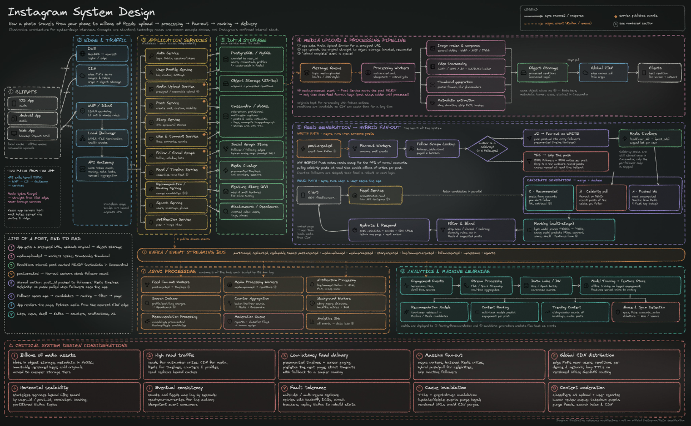

# Instagram Backend

A learning-focused Instagram-style social application built as a modular monolith backend and a separate React web client.

> **Project status:** The system is being built incrementally. See [Roadmap.md](Roadmap.md) for delivery status.

## Product vision

Build the backend for a photo-sharing social network: authentication, profiles, posts, follow graph, privacy, chronological feed, media handling, engagement, notifications, and eventually ranking and analytics.



The target architecture is broader than the current implementation. PostgreSQL is the source of truth; Redis, object storage, event streaming, workers, and analytics are introduced incrementally.

## Current repository layout

```text
backend/       FastAPI application, domain modules, tests, migrations, Python tooling
frontend/      React + TypeScript + Vite web application
docs/          Architecture decisions and learning notes
infra/         Monitoring configuration
docker-compose.yml  Local infrastructure orchestration
Makefile       Root-level development commands
```

The backend is a modular monolith. Domain modules live under `backend/app/modules/` and follow router/service/repository boundaries. The frontend consumes the existing versioned API through the Vite development proxy.

## Requirements

- Python 3.15+
- [uv](https://docs.astral.sh/uv/)
- Node.js 20.19+ or 22.12+
- npm
- Docker Compose v2

## One-time setup

```bash
cp .env.example .env
openssl rand -hex 32
```

Set the generated value as `AUTH_JWT_SECRET` in the root `.env` file. Do not use local defaults outside your machine.

## Start backend and frontend together

From the repository root:

```bash
make dev
```

This starts PostgreSQL and Redis, syncs backend dependencies, applies migrations, and starts FastAPI and Vite.

- Frontend: http://127.0.0.1:5173
- API: http://127.0.0.1:8000
- API docs: http://127.0.0.1:8000/docs

Press `Ctrl+C` to stop both development servers. Stop local infrastructure with `docker compose down`.

## Seed local demo data

```bash
make seed
```

The seeder creates a small additive demo dataset. Local demo accounts use password `DemoPassword123!` (for example, `demo_alice@example.com`).

## Development checks

Run these from the repository root:

```bash
make test
make lint
make typecheck
make migrate
```

For backend-specific setup and commands, see [backend/README.md](backend/README.md). For frontend-specific details, see [frontend/README.md](frontend/README.md).

## Learning path

1. Users and authentication
2. Posts and media metadata
3. Follow graph and privacy/visibility rules
4. Direct media upload and asynchronous processing
5. Likes, comments, and engagement events
6. Feed read path and baseline ranking
7. Hybrid fan-out and timeline optimization
8. Notifications, counters, and search indexing
9. Observability, load testing, and reliability
10. Analytics and recommendation experiments

See the [project roadmap](Roadmap.md), [architecture overview](docs/architecture.md), and [learning notes](docs/learnings/).
