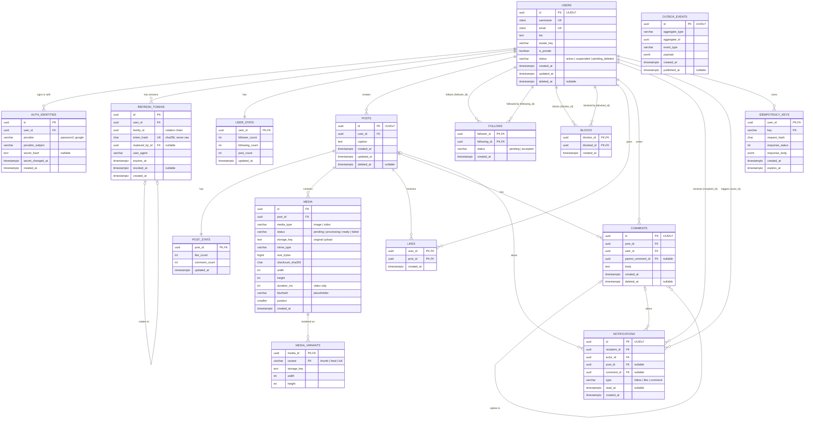

# Instagram-style ER diagram

The relationships below model the PostgreSQL source of truth. Feed timelines
and notification delivery can be materialized in Redis, but the relational
tables remain authoritative.

# Instagram-style ER diagram

PostgreSQL is the source of truth. Redis timelines, counters, and
notification delivery are derived projections, fed by `OUTBOX_EVENTS`.



`OUTBOX_EVENTS` has no relationship lines on purpose: events must outlive
the rows they describe.

## Scale-aware design notes

- `FOLLOWS`, `LIKES`, and `COMMENTS` are high-write tables. Use composite
  primary keys for follows and likes to prevent duplicates.
- Add these uniqueness and integrity rules:
  - `AUTH_IDENTITIES(provider, provider_subject) UNIQUE`.
  - `MEDIA(post_id, position) UNIQUE`.
  - `follower_id <> following_id` and `blocker_id <> blocked_id`.
  - `NOTIFICATIONS.type` must agree with its nullable `post_id` and
    `comment_id` references: likes require a post, comments require a
    comment, and follows require neither. A comment notification may also
    carry its post ID for efficient navigation.
- Add indexes for `posts(user_id, created_at, id)`,
  `posts(created_at, id)`, `follows(following_id, created_at)`,
  `follows(follower_id, created_at)`, `likes(post_id, created_at)`,
  `comments(post_id, created_at)`, `notifications(recipient_id, created_at)`,
  `outbox_events(published_at, created_at)`, and
  `refresh_tokens(user_id, revoked_at, expires_at)`.
- `REFRESH_TOKENS.replaced_by_id` references `REFRESH_TOKENS(id)` to model
  refresh-token rotation.
- The estimate of 4M posts/day and approximately 2 TB/day of media means
  `MEDIA` should store object-storage keys and metadata. Store image/video
  bytes in object storage, not PostgreSQL.
- The 200M feed reads/day estimate favors a Redis timeline containing bounded
  post IDs. Keep the full post, media, and interaction data in PostgreSQL or
  other durable stores.
- The Redis estimate should distinguish active users from all users. With
  20M active users, 500 entries, and 64 raw bytes per entry, the raw estimate
  is about 640 GB; with all 100M users it is about 3.2 TB. Sorted-set/list
  overhead, replication, and fragmentation must be added to either figure.
- Notifications should be written asynchronously from likes, comments, and
  follows. For celebrity accounts, avoid synchronously expanding a post to
  every follower; use hybrid fanout-on-write and fanout-on-read.
- At the estimated scale, partition or archive time-heavy tables such as
  `POSTS`, `COMMENTS`, `LIKES`, and `NOTIFICATIONS` by time after measuring
  query patterns. Retain `OUTBOX_EVENTS`, `IDEMPOTENCY_KEYS`,
  `NOTIFICATIONS`, and expired/revoked `REFRESH_TOKENS` only for their
  required operational or audit windows, then archive or delete them.

## Recommended SQL constraints

```sql
CREATE UNIQUE INDEX auth_identities_provider_subject_uq
    ON auth_identities (provider, provider_subject);

CREATE UNIQUE INDEX media_post_position_uq
    ON media (post_id, position);

ALTER TABLE refresh_tokens
    ADD CONSTRAINT refresh_tokens_replaced_by_fk
    FOREIGN KEY (replaced_by_id) REFERENCES refresh_tokens (id);

ALTER TABLE follows
    ADD CONSTRAINT follows_no_self_follow
    CHECK (follower_id <> following_id);

ALTER TABLE blocks
    ADD CONSTRAINT blocks_no_self_block
    CHECK (blocker_id <> blocked_id);

ALTER TABLE notifications
    ADD CONSTRAINT notifications_reference_check
    CHECK (
        (type = 'like' AND post_id IS NOT NULL AND comment_id IS NULL)
        OR (type = 'comment' AND comment_id IS NOT NULL)
        OR (type = 'follow' AND post_id IS NULL AND comment_id IS NULL)
    );
```
