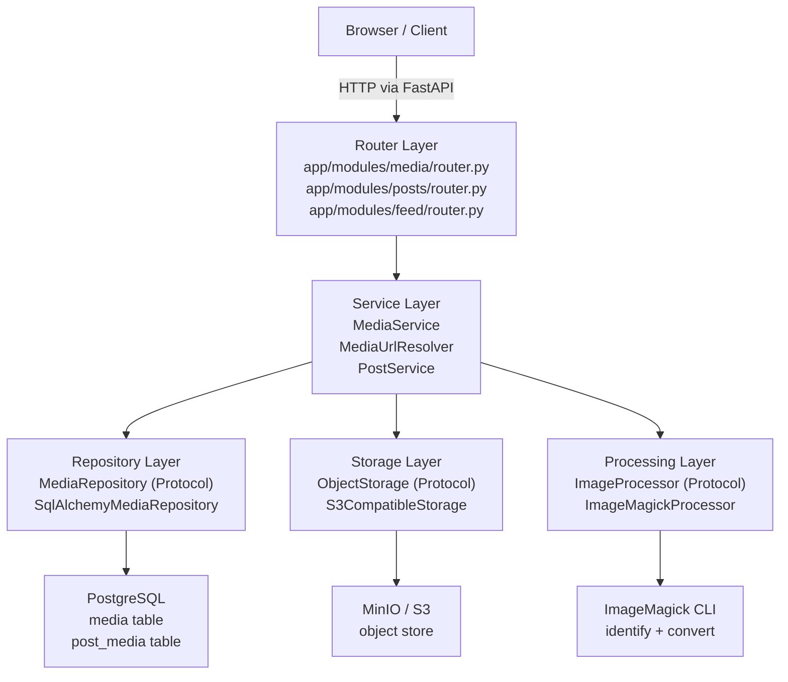
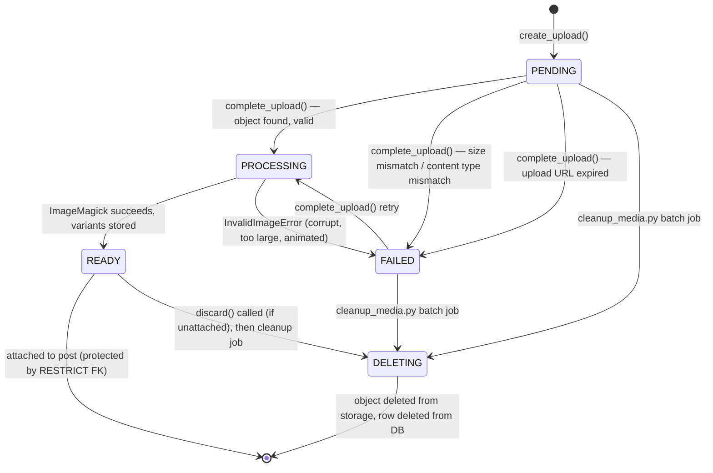

# PR #13 — Complete Media Lifecycle: Deep-Dive Explanation

> [!IMPORTANT]
> This PR (merged from `feature/complete-media-lifecycle`) is the largest change to the backend so far: **40 files changed, 2,638 insertions, 92 deletions**. It introduces the entire image upload, processing, storage, delivery, and cleanup pipeline.

---

## 1. What Was This PR About — The Problem It Solved

Before this PR, posts stored images as **plain URLs** in a `post_images` table. Those URLs were:
- Externally hosted (Imgur, Cloudinary, etc.) — the backend had zero control
- Never validated — any URL string was accepted
- Never processed — no resizing, no metadata stripping, no format conversion
- Publicly accessible to anyone who had the URL — no authorization enforcement
- Never cleaned up — orphan records just sat in the database forever

**The PR replaces all of this with a full media lifecycle:**

```
Before:  Client POSTs { url: "https://imgur.com/xyz" }  →  stored as plain string
After:   Client requests presigned PUT URL               →  uploads directly to MinIO/S3
         Client signals upload complete                  →  backend validates, processes, stores WebP variants
         Client creates post with media_id               →  backend enforces ownership & readiness
         Feed/post responses                             →  backend signs short-lived GET URLs after auth check
         Cleanup job                                     →  purges abandoned/deleted media from storage and DB
```

---

## 2. The Architecture — 5 Layers



Every layer is backed by a **Protocol** (interface), keeping them decoupled and independently testable. The concrete implementations are only wired together in `dependencies.py`.

---

## 3. New Files — What Each One Does

| File | Purpose |
| :--- | :--- |
| `media/models.py` | Pure immutable `Media` dataclass + `MediaStatus` constants |
| `media/storage/interfaces.py` | `ObjectStorage` Protocol + `StoredObject` dataclass |
| `media/storage/s3.py` | AWS Signature V4 adapter — works with MinIO and real S3 |
| `media/processing.py` | `ImageProcessor` Protocol + `ImageMagickProcessor` |
| `media/repository.py` | `MediaRepository` Protocol + `SqlAlchemyMediaRepository` |
| `media/service.py` | `MediaService` (upload lifecycle) + `MediaUrlResolver` (signed delivery) |
| `media/router.py` | 4 HTTP endpoints: upload-url, complete, get status, discard |
| `media/schemas.py` | Pydantic request/response models |
| `media/dependencies.py` | FastAPI dependency factory functions |
| `migrations/005_media_assets.py` | DB schema: `media` table, `post_media` join table, legacy data migration |
| `scripts/cleanup_media.py` | Scheduled one-shot job: purge abandoned/deleted media |

---

## 4. The `Media` Domain Model

```python
@dataclass(frozen=True, slots=True)
class Media:
    id: UUID
    owner_id: UUID
    object_key: str | None        # path in storage, e.g. original/{owner_id}/{media_id}/source
    url: str | None               # legacy URL-backed images only
    content_type: str | None      # image/jpeg, image/png, image/webp
    size_bytes: int | None        # actual size after upload
    status: str                   # one of MediaStatus constants
    width: int | None             # original pixel width
    height: int | None            # original pixel height
    expected_size_bytes: int | None   # size declared at upload time (used for validation)
    upload_expires_at: datetime | None  # when the presigned PUT URL expires
    display_object_key: str | None      # processed/owner_id/media_id/display.webp
    thumbnail_object_key: str | None    # processed/owner_id/media_id/thumbnail.webp
    cleanup_requested_at: datetime | None  # when discard() was called
    failure_reason: str | None    # human-readable failure description
```

### Why all these nullable fields?
Each field is progressively populated through the lifecycle. At creation, only `id`, `owner_id`, `object_key`, `content_type`, `expected_size_bytes`, `status=PENDING` are set. After processing completes, `size_bytes`, `width`, `height`, `display_object_key`, `thumbnail_object_key` are filled. This avoids a separate "pending" and "ready" table.

---

## 5. The `MediaStatus` State Machine



> [!NOTE]
> `DELETING` is a terminal transitional state set by the cleanup job. It signals "this row is being processed for deletion." The row is only hard-deleted from the DB after all storage objects are confirmed deleted.

---

## 6. The Storage Layer — Why a Hand-Rolled S3 Adapter?

### Decision: No boto3 / aioboto3

The PR implements AWS Signature V4 signing from scratch using Python's `urllib` and `hmac`. This was deliberate:

1. **No heavyweight dependency** — `boto3` pulls in botocore (~12MB), which is overkill for presigned URLs and a few object operations.
2. **Zero async runtime coupling** — `boto3` is synchronous; `aioboto3` requires careful thread/event-loop management. The hand-rolled adapter uses `asyncio.to_thread()` to push sync I/O off the event loop cleanly.
3. **Full control over dual endpoints** — The adapter separates:
   - **Internal endpoint** (`media_storage_endpoint_url`): used by the app container to call MinIO (e.g. `http://minio:9000`)
   - **Public endpoint** (`media_storage_public_endpoint_url`): used in presigned URLs sent to the browser (e.g. `http://localhost:9000`)
   
   This distinction is critical in Docker Compose: the browser cannot reach `http://minio:9000`, but the app container can't sign URLs with `localhost:9000` and expect them to work from the browser.

### `ObjectStorage` Protocol

```python
class ObjectStorage(Protocol):
    def presign_put_url(self, object_key: str, *, expires_in: int) -> str: ...
    def presign_get_url(self, object_key: str, *, expires_in: int) -> str: ...
    async def ensure_bucket(self) -> None: ...
    async def head_object(self, object_key: str) -> StoredObject: ...
    async def get_object(self, object_key: str, *, max_bytes: int) -> bytes: ...
    async def put_object(self, object_key: str, data: bytes, *, content_type: str) -> None: ...
    async def delete_object(self, object_key: str) -> None: ...
```

**Why Protocol?** Tests can inject a `FakeObjectStorage` that never touches MinIO. The service only depends on the interface.

---

## 7. The Processing Layer — ImageMagick

### Decision: ImageMagick over Pillow

> [!NOTE]
> This was a deliberate ADR decision. See `docs/adr/0002-image-media-lifecycle.md` §"Use ImageMagick via subprocess for image validation and processing."

| | Pillow | ImageMagick |
| :--- | :--- | :--- |
| Installation | pip package | System binary |
| Memory isolation | In-process | Subprocess — crash = no server crash |
| Decompression bomb risk | Mitigated with `PIL.Image.MAX_IMAGE_PIXELS` | Mitigated with `-limit memory/map/disk` flags |
| Multi-format support | Good | Excellent |
| Animated GIF | Requires separate check | `%n` frame count in `identify` output |
| Output format | Pillow WebP | Native WebP via `convert ... webp:-` |

**Security hardening flags used:**
```
-limit memory 128MiB   # max memory per operation
-limit map 256MiB      # max memory-mapped files
-limit disk 512MiB     # max temp disk usage
-limit time 15         # kill after 15 seconds
-limit thread 1        # single-threaded (prevents fork bombs)
```

### What ImageMagick does per upload
1. **`identify`** — reads format, width, height, frame count. Validates: format matches content-type, single frame only, dimensions ≤ 8000×8000, pixel count ≤ 40M.
2. **`convert` → display.webp** — strips EXIF metadata (`-strip`), auto-rotates from EXIF orientation (`-auto-orient`), resizes to fit within 1600×1600 (`-resize 1600x1600>`), quality 85.
3. **`convert` → thumbnail.webp** — strips metadata, 320×320 center-crop (`-thumbnail 320x320^ -gravity center -extent 320x320`), quality 80.

**Why strip EXIF?**
GPS coordinates, device model, shooting location can all be embedded in EXIF. Stripping it protects user privacy by default.

**Why WebP output?**
~25–35% smaller than JPEG at equivalent quality. Modern browser support is universal (96%+). Two variants (display + thumbnail) avoid serving a 1600px image for a 60×60 feed thumbnail slot.

---

## 8. The Service Layer — `MediaService`

```python
class MediaService:
    def __init__(
        self,
        repository: MediaRepository,
        storage: ObjectStorage,
        processor: ImageProcessor,
    ) -> None:
```

All three dependencies are injected as interfaces. `MediaService` never imports `S3CompatibleStorage` or `ImageMagickProcessor` directly.

### `create_upload()` — What It Does

1. Validates `content_type` ∈ `{image/jpeg, image/png, image/webp}`.
2. Validates `size_bytes` within `(0, 10MB]`.
3. Calls `ensure_bucket()` to create the MinIO bucket if missing.
4. Generates a UUIDv7 for the media record.
5. Computes `object_key = f"original/{owner_id}/{media_id}/source"`.
6. Inserts a `Media` row with `status=PENDING` and an `upload_expires_at` 15 minutes out.
7. Calls `presign_put_url()` and returns an `UploadTicket` to the caller.

> [!IMPORTANT]
> The presigned URL is generated **after** the DB row is committed. This ensures the row always exists before the client starts uploading. If the presign failed, the client would have an orphan row — but that's handled by the cleanup job, not by blocking the response.

### `complete_upload()` — The Most Complex Method

This is the heart of the lifecycle. Here is the full state-guarded logic:

```
1. Fetch row with FOR UPDATE lock (prevents concurrent complete calls)
2. Check ownership (owner_id must match actor)
3. If status = DELETING or cleanup_requested_at set → 409 Conflict
4. If status = READY → return as-is (idempotent)
5. If status not in {PENDING, FAILED} → 409 Conflict
6. HEAD the object in storage:
   - If not found AND upload_expires_at has passed → mark FAILED, schedule cleanup, return
   - If not found AND URL still valid → 409 "upload it before completing"
7. Validate size_bytes matches expected_size_bytes (prevents truncated uploads)
8. Validate content_type matches declaration
9. Transition to PROCESSING, flush
10. GET object bytes (with max_bytes cap)
11. Run ImageMagickProcessor.process()
    - If InvalidImageError → mark FAILED, return
12. PUT display.webp to storage
13. PUT thumbnail.webp to storage
14. Transition to READY with size, dimensions, variant keys
15. Return READY media
```

> [!WARNING]
> Step 9–14 runs **inside the same HTTP request and database transaction**. Object storage calls and ImageMagick subprocess execution hold the transaction open. This is the acknowledged trade-off in ADR §"Accepted limitations."

### `discard()` — Soft-Schedule for Cleanup

```python
async def discard(self, *, owner_id: UUID, media_id: UUID) -> Media:
    # ...ownership checks...
    attached = await self._repository.get_attached_ids([media_id])
    if attached:
        raise MediaConflictError("attached media cannot be discarded")
    return await self._repository.save(
        replace(media, cleanup_requested_at=datetime.now(UTC), ...)
    )
```

**Why not delete immediately?**
- Object deletion requires two coordinated steps: storage DELETE + DB row DELETE. Doing this synchronously in a request risks partial state if storage is slow or fails.
- The cleanup job handles this durably with SKIP LOCKED and retry logic.
- Returns `HTTP 202 Accepted` — the resource is scheduled, not yet deleted.

### `MediaUrlResolver` — Signed URL Generation After Authorization

```python
class MediaUrlResolver:
    async def resolve(self, images: tuple[ImageReference, ...]) -> list[ResolvedImage]:
```

**Why is this separate from MediaService?**

The resolver is called by the **feed** and **post** routers, *after* visibility and authorization checks have already passed. It batch-fetches all media records for a page of feed items in a single query, then signs each URL. This is a clean separation:

1. `FeedService` / `PostService` → enforces *who can see what*
2. `MediaUrlResolver` → generates *how to fetch it* (signs the URL)

If URL signing happened inside `MediaService`, it would need visibility knowledge. This way neither service knows about the other's concerns.

**Batch hydration** — instead of N queries for N images in a feed page:
```python
media_by_id = {
    media.id: media
    for media in await self._repository.get_by_ids(media_ids)  # single IN query
}
```

---

## 9. Database Changes — Migration 005

### New `media` table

```sql
CREATE TABLE media (
    id               UUID PRIMARY KEY,
    owner_id         UUID NOT NULL REFERENCES users(id) ON DELETE CASCADE,
    object_key       VARCHAR(512),          -- storage path for original
    url              VARCHAR(2048),         -- legacy URL-backed images
    content_type     VARCHAR(100),
    size_bytes       BIGINT,
    expected_size_bytes BIGINT,
    status           VARCHAR(20) NOT NULL,
    width            INTEGER,
    height           INTEGER,
    display_object_key   VARCHAR(512),      -- storage path for processed display
    thumbnail_object_key VARCHAR(512),      -- storage path for thumbnail
    upload_expires_at    TIMESTAMPTZ,
    cleanup_requested_at TIMESTAMPTZ,
    failure_reason   VARCHAR(240),
    created_at       TIMESTAMPTZ NOT NULL,
    updated_at       TIMESTAMPTZ NOT NULL,

    CONSTRAINT media_status_check CHECK (
        status IN ('pending', 'processing', 'ready', 'failed', 'deleting')
    )
);
```

**Indexes:**
```sql
-- For cleanup job: find media by owner
CREATE INDEX ix_media_owner_created ON media (owner_id, created_at);

-- For cleanup job: find all pending/failed media
CREATE INDEX ix_media_status_created ON media (status, created_at);

-- For cleanup job: partial index — only rows with cleanup scheduled
CREATE INDEX ix_media_cleanup_requested ON media (cleanup_requested_at)
    WHERE cleanup_requested_at IS NOT NULL;
```

The partial index on `cleanup_requested_at` is a key optimization — it only indexes rows that actually need cleanup, keeping it small and fast.

### `post_images` → `post_media` migration

The old `post_images` table stored raw URLs. The migration:
1. Adds `media_id UUID` column to the existing table.
2. Generates a new UUID for each existing row.
3. `INSERT INTO media` for each old image row (with `status='ready'`, `url=<old url>`, `object_key=NULL`) — these are legacy-URL-backed records.
4. Renames `post_images` → `post_media`.
5. Makes `media_id NOT NULL`.
6. Adds `FOREIGN KEY (media_id) REFERENCES media(id) ON DELETE RESTRICT`.
7. Adds `UNIQUE (media_id)` — **each media record can only be attached to one post**.

> [!IMPORTANT]
> `ON DELETE RESTRICT` on the foreign key means you **cannot delete a `media` row while it is attached to a post**. This is enforced at the DB level, not just application level. The cleanup script's `get_attached_ids()` check is application-level defense-in-depth.

### Why `UNIQUE (media_id)` on `post_media`?

One media asset = one post. This prevents:
- A user uploading one image and attaching it to 100 posts
- Race conditions where two concurrent post-creation requests both attach the same media

---

## 10. Posts Module Changes

### Before
```python
# post creation accepted a list of raw URLs
image_urls: list[str]
```

### After
```python
# post creation accepts media IDs (or legacy URLs for backward compat)
media_ids: list[UUID] | None = None
image_urls: list[str] | None = None   # kept for legacy clients
```

New validation in `PostService.create_post()`:
```python
if (image_urls is None) == (media_ids is None):
    raise ValueError("provide either image URLs or media_ids, not both")

if media_ids is not None and self._media is None:
    raise ValueError("media repository is required to use media_ids")
```

When `media_ids` is provided, the service:
1. Locks all referenced media rows with `FOR UPDATE`.
2. Checks all media exist → `PostMediaNotFoundError` if any missing.
3. Checks all media are owned by the actor → `PostMediaForbiddenError`.
4. Checks all media are `status=READY` → `PostMediaNotReadyError`.
5. Checks none are already attached (`UNIQUE` constraint would catch this, but explicit check gives a better error) → `PostMediaAlreadyAttachedError`.
6. Inserts `post_media` rows in a single batch.

New domain errors added:
- `PostMediaNotFoundError`
- `PostMediaForbiddenError`
- `PostMediaNotReadyError`
- `PostMediaAlreadyAttachedError`

---

## 11. Feed Changes

The feed router now injects `MediaUrlResolver` as a dependency:

```python
@router.get("/feed")
async def get_home_feed(
    viewer: User,
    service: FeedService,
    media_urls: MediaUrlResolver,   # ← new
    ...
):
    page = await service.get_feed(...)
    # Collect ALL images from ALL posts in the page
    all_images = tuple(image for item in page.items for image in item.post.images)
    # Batch-resolve signed URLs in ONE call (one DB query + N presigns)
    resolved_images = await media_urls.resolve(all_images)
    # Map resolved URLs back to posts
    ...
```

**Why resolve after the feed query?**
The feed query returns `Post` objects with `PostImage` records containing `media_id` or legacy `url`. The `MediaUrlResolver` then:
- Skips images that already have a `url` (legacy)
- Batch-fetches all `Media` rows needed for the page
- Calls `presign_get_url()` for each `display_object_key`

Signed GET URLs are generated **after** the feed query has already enforced visibility (following, blocking, private account rules). This is a deliberate security boundary.

---

## 12. The Cleanup Job — `scripts/cleanup_media.py`

This runs periodically (`make cleanup-media`). It is a **one-shot script**, not a continuously running worker.

### Why not a background async task?

The ADR explicitly chose a scheduled one-shot job because:
- It is stateless and safe to retry
- It doesn't need to run continuously — orphans accumulate slowly
- A background task adds process management complexity for limited gain
- `SKIP LOCKED` makes concurrent runs safe

### How the cleanup claim works

```sql
WITH candidates AS (
    SELECT m.id FROM media AS m
    WHERE
        -- not attached to any post
        NOT EXISTS (SELECT 1 FROM post_media WHERE post_media.media_id = m.id)
        -- upload URL has fully expired (5-min safety window on top)
        AND (m.upload_expires_at IS NULL OR m.upload_expires_at <= :safe_before)
        AND (
            m.status = 'deleting'            -- already claimed by previous run
            OR m.cleanup_requested_at <= :now -- explicitly discarded
            OR (
                m.created_at <= :expired_before   -- abandoned for 24+ hours
                AND m.status IN ('pending', 'failed', 'ready')
            )
        )
    ORDER BY COALESCE(m.cleanup_requested_at, m.created_at), m.id
    LIMIT :batch_size
    FOR UPDATE SKIP LOCKED   -- concurrent-safe claim
)
UPDATE media SET status = 'deleting', updated_at = :now
FROM candidates WHERE m.id = candidates.id
RETURNING m.id, m.owner_id, m.object_key, m.display_object_key, m.thumbnail_object_key
```

**`FOR UPDATE SKIP LOCKED`**: If two cleanup processes run concurrently, they each claim different rows and never block each other. No locks held longer than the claim transaction.

### Cleanup sequence per row

```
1. Transition claimed rows to DELETING (atomic batch, committed immediately)
2. For each claimed row:
   a. Delete original object key from storage
   b. Delete display_object_key from storage
   c. Delete thumbnail_object_key from storage
   d. Also attempt to delete computed paths (defence against stale keys)
   e. If any storage delete fails → skip row (leave as DELETING, retry next run)
   f. If all deletes succeed → DELETE FROM media WHERE id=X AND status='deleting'
      AND NOT EXISTS (SELECT 1 FROM post_media ...)  ← safety re-check
```

**Why the final re-check?** Between the claim and the row delete, it's theoretically possible for a post to have been attached (though the RESTRICT FK should prevent this). The re-check is defense-in-depth.

### Soft-deleted post cleanup

Before claiming orphans, the script:
1. Sets `cleanup_requested_at` on media rows whose post was soft-deleted > 24 hours ago.
2. Deletes `post_media` join table rows for those posts (detaches the media so the normal claim picks it up).

This gives a 24-hour grace period for post recovery before media is permanently removed.

---

## 13. Full End-to-End Data Flow — Real Example

**Scenario:** User alice (ID: `0193d2f4-...`) uploads a JPEG photo and creates a post.

### Phase 1 — Request Upload Ticket

```
Client → POST /api/v1/media/upload-url
{
  "content_type": "image/jpeg",
  "size_bytes": 2097152    ← 2MB
}
```

**Inside `MediaService.create_upload()`:**

```python
# 1. Validate
content_type ∈ ALLOWED_CONTENT_TYPES  ✅
size_bytes = 2097152 <= 10_485_760    ✅

# 2. Ensure bucket exists (HEAD bucket → not found → PUT bucket)
await storage.ensure_bucket()

# 3. Create record
media_id = new_uuid7()  → "0193e1a2-b3c4-7d05-8e6f-1a2b3c4d5e6f"
object_key = "original/0193d2f4-.../0193e1a2-.../source"
expires_at = now + 15min

# 4. INSERT into media with status=PENDING
await repository.add(Media(id=media_id, status="pending", ...))

# 5. Sign the PUT URL (AWS SigV4, expires_in=900s, public endpoint)
upload_url = "http://localhost:9000/instagram-media/original/.../source?X-Amz-..."
```

**Response:**
```json
{
  "media_id": "0193e1a2-b3c4-7d05-8e6f-1a2b3c4d5e6f",
  "upload_url": "http://localhost:9000/instagram-media/original/.../source?X-Amz-Algorithm=...",
  "method": "PUT",
  "content_type": "image/jpeg",
  "expires_at": "2026-11-16T05:00:00Z"
}
```

**DB state after Phase 1:**
```
media row: id=0193e1a2, status=PENDING, object_key="original/...", size_bytes=NULL,
           width=NULL, height=NULL, display_object_key=NULL, thumbnail_object_key=NULL
```

---

### Phase 2 — Browser Uploads Directly to MinIO

```
Browser → PUT http://localhost:9000/instagram-media/original/.../source?X-Amz-...
Content-Type: image/jpeg
[2MB JPEG bytes]

MinIO → 200 OK
```

The backend is **not involved** in this step. The browser pushes bytes directly to MinIO using the presigned URL. No API bandwidth consumed.

---

### Phase 3 — Signal Upload Complete

```
Client → POST /api/v1/media/0193e1a2-.../complete
Authorization: Bearer <access_token>
```

**Inside `MediaService.complete_upload()`:**

```python
# 1. Lock row
media = await repository.get_by_id_for_update(media_id)
# → SELECT ... FOR UPDATE

# 2. Ownership check
media.owner_id == actor.id  ✅

# 3. State check
media.status == PENDING  ✅ (can proceed)

# 4. HEAD the object
stored = await storage.head_object("original/.../source")
# → HTTP HEAD presigned URL to MinIO
# → Returns StoredObject(size_bytes=2097152, content_type="image/jpeg")

# 5. Validate size
stored.size_bytes == media.expected_size_bytes  ✅ (both 2097152)

# 6. Validate content_type
stored.content_type == media.content_type  ✅ (both "image/jpeg")

# 7. Transition to PROCESSING
await repository.save(replace(media, status="processing"))

# 8. Download the object
source_bytes = await storage.get_object("original/.../source", max_bytes=10_485_760)

# 9. Process with ImageMagick (in thread)
processed = await processor.process(source_bytes, declared_content_type="image/jpeg")

#    ImageMagick identify: JPEG|3000|2000|1  ← format|width|height|frames
#    3000 <= 8000, 2000 <= 8000, 3000*2000=6M <= 40M  ✅
#    ImageMagick convert → display.webp (1600x1067, stripped EXIF, quality 85)
#    ImageMagick convert → thumbnail.webp (320x320 center crop, quality 80)

# 10. Store processed variants
await storage.put_object("processed/.../display.webp", display_bytes, content_type="image/webp")
await storage.put_object("processed/.../thumbnail.webp", thumbnail_bytes, content_type="image/webp")

# 11. Transition to READY
ready = replace(processing,
    status="ready",
    size_bytes=2097152,
    width=3000, height=2000,
    display_object_key="processed/.../display.webp",
    thumbnail_object_key="processed/.../thumbnail.webp",
)
await repository.save(ready)
```

**DB state after Phase 3:**
```
media row: id=0193e1a2, status=READY, size_bytes=2097152,
           width=3000, height=2000,
           display_object_key="processed/.../display.webp",
           thumbnail_object_key="processed/.../thumbnail.webp"
```

**Response:**
```json
{
  "media_id": "0193e1a2-b3c4-7d05-8e6f-1a2b3c4d5e6f",
  "status": "ready",
  "content_type": "image/jpeg",
  "size_bytes": 2097152,
  "width": 3000,
  "height": 2000,
  "failure_reason": null,
  "cleanup_requested_at": null
}
```

---

### Phase 4 — Create a Post with the Media

```
Client → POST /api/v1/posts
{
  "caption": "Beautiful sunset 🌅",
  "media_ids": ["0193e1a2-b3c4-7d05-8e6f-1a2b3c4d5e6f"]
}
```

**Inside `PostService.create_post()` with media:**

```python
# 1. Lock media rows
media_rows = await media_repo.get_by_ids_for_update([media_id])

# 2. All exist
# 3. All owned by actor (owner_id == actor.id)
# 4. All READY (status == "ready")
# 5. None already attached
already_attached = await media_repo.get_attached_ids([media_id])  → empty set  ✅

# 6. Create post row
post_id = new_uuid7()
await posts_repo.add(Post(id=post_id, user_id=actor.id, ...))

# 7. Create post_media join rows
await posts_repo.add_post_media([
    PostMediaRow(post_id=post_id, media_id=media_id, position=0)
])
```

**DB state after Phase 4:**
```
posts row: id=post_id, user_id=0193d2f4, caption="Beautiful sunset 🌅"
post_media row: post_id=post_id, media_id=0193e1a2, position=0
```

---

### Phase 5 — Feed Renders Signed Image URL

```
Client → GET /api/v1/feed
Authorization: Bearer <access_token>
```

**Inside feed router:**

```python
# 1. FeedService returns page of posts including Post(images=[PostImage(media_id=0193e1a2)])
page = await service.get_feed(viewer_id=alice.id, ...)

# 2. Collect all image references from the page
all_images = (PostImage(position=0, media_id="0193e1a2", url=None),)

# 3. MediaUrlResolver.resolve() — AFTER authorization passed
# → Single DB query: SELECT * FROM media WHERE id IN ('0193e1a2')
media_by_id = {UUID("0193e1a2"): Media(status="ready", display_object_key="processed/.../display.webp")}

# 4. Sign GET URL (expires in 15 min)
signed_url = storage.presign_get_url("processed/.../display.webp", expires_in=900)
# → "http://localhost:9000/instagram-media/processed/.../display.webp?X-Amz-..."
```

**Response (one post in feed):**
```json
{
  "id": "post-uuid",
  "username": "alice",
  "caption": "Beautiful sunset 🌅",
  "post_img_url": [
    {
      "position": 0,
      "url": "http://localhost:9000/instagram-media/processed/.../display.webp?X-Amz-Algorithm=..."
    }
  ]
}
```

The browser now fetches the image directly from MinIO using the **15-minute signed URL**. After expiry, the URL stops working — the client must request a fresh feed to get a new signed URL. This prevents stale URLs from permanently surfacing private images.

---

## 14. Security Design Decisions

| Decision | Rationale |
| :--- | :--- |
| **Private bucket** (no public-read ACL) | Images are only accessible via signed URLs. A direct URL without a valid signature returns 403. This enforces that all image access goes through the API's authorization checks. |
| **Short-lived signed GET URLs (15 min)** | Prevents indefinite access to images if a URL is shared or cached by a CDN. Also limits exposure if a private post is later made public (old URLs expire). |
| **Signed PUT URL contains exact `object_key`** | The browser can only upload to the specific path the backend prescribes (`original/{owner_id}/{media_id}/source`). It cannot overwrite other users' files. |
| **`expected_size_bytes` declared at ticket time** | The backend compares the actual stored object size against what the client declared. A truncated or padded upload is rejected. |
| **Magic bytes + content-type validation** | `detect_image_content_type()` reads the actual file header bytes, independent of the HTTP `Content-Type` header. A JPEG file renamed as `.png` with `Content-Type: image/png` is detected and rejected. |
| **EXIF stripping** | Prevents GPS coordinates, device fingerprints, and other metadata from being embedded in delivered images. |
| **`owner_id` in object_key path** | Even if someone guesses a `media_id`, they cannot know the `owner_id` prefix, making brute-forcing object paths much harder. |
| **`FOR UPDATE` lock in `complete_upload()`** | Prevents two concurrent requests from both passing the PENDING check and running ImageMagick twice on the same media record. |
| **`UNIQUE (media_id)` on `post_media`** | Enforced at the database level — a media asset can only be attached to one post, even under concurrent requests. |

---

## 15. Config Changes (`core/config.py`)

7 new settings added:

```python
media_storage_endpoint_url: str = "http://localhost:9000"         # internal app → MinIO
media_storage_public_endpoint_url: str = "http://localhost:9000"  # browser → MinIO
media_storage_bucket: str = "instagram-media"
media_storage_region: str = "us-east-1"
media_storage_access_key: str = "minioadmin"
media_storage_secret_key: str = "minioadmin"
media_upload_ttl_seconds: int = 900          # 15 min presigned PUT expiry
media_download_ttl_seconds: int = 900        # 15 min presigned GET expiry
media_max_upload_bytes: int = 10_485_760     # 10 MB hard cap
media_cleanup_grace_hours: int = 24          # hours before abandoned media is cleaned
```

In production, `endpoint_url` = internal cluster URL (e.g. `http://minio.internal:9000`), `public_endpoint_url` = public CDN or gateway (e.g. `https://media.yourapp.com`).

---

## 16. Known Trade-offs and Follow-up Work

> [!WARNING]
> The PR itself documents these in the ADR — they are accepted limitations, not bugs.

| Trade-off | Description | Follow-up |
| :--- | :--- | :--- |
| **Synchronous processing in request** | ImageMagick runs inside the HTTP request, holding the DB transaction. A slow or large image can hold a row lock open for seconds. | Move to a durable worker queue (Celery, ARQ) with outbox pattern for transactional durability. |
| **Non-atomic storage+DB write** | If the server crashes after storing `display.webp` but before storing `thumbnail.webp`, partial objects remain. The row will be in `PROCESSING` and there's no auto-recovery yet. | Add stale `PROCESSING` recovery: cleanup job detects rows stuck in PROCESSING > N minutes and re-runs or marks FAILED. |
| **No failure-path MinIO integration tests** | Only the happy path is tested end-to-end with a real MinIO. Invalid payload, wrong size, expired URL, storage outage, and partial variant write cases are unit-tested but not integration-tested. | Add MinIO-backed failure-path tests in CI. |
| **Signed URLs are bearer tokens** | A signed URL grants access until expiry to anyone who has it. Logging systems, browser history, referrer headers could leak them. | Keep TTL short. Add CDN with signed-token invalidation for production. Never log full URLs. |
